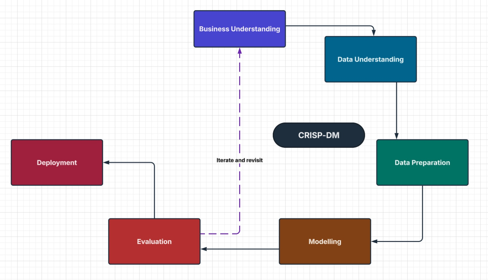
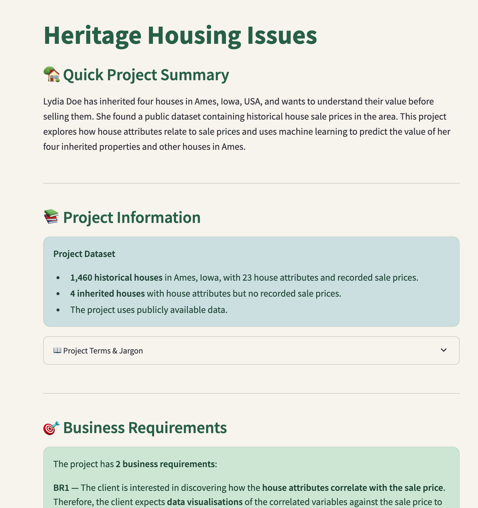
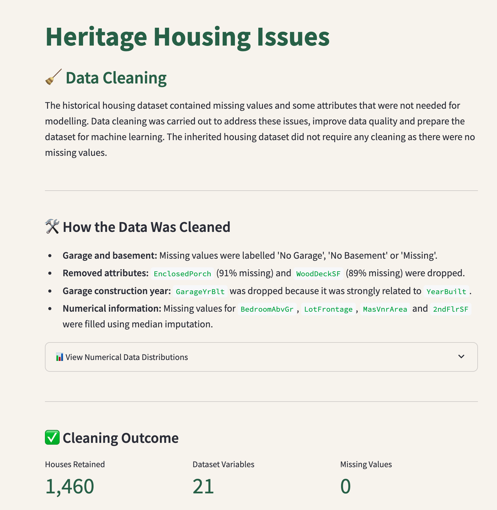
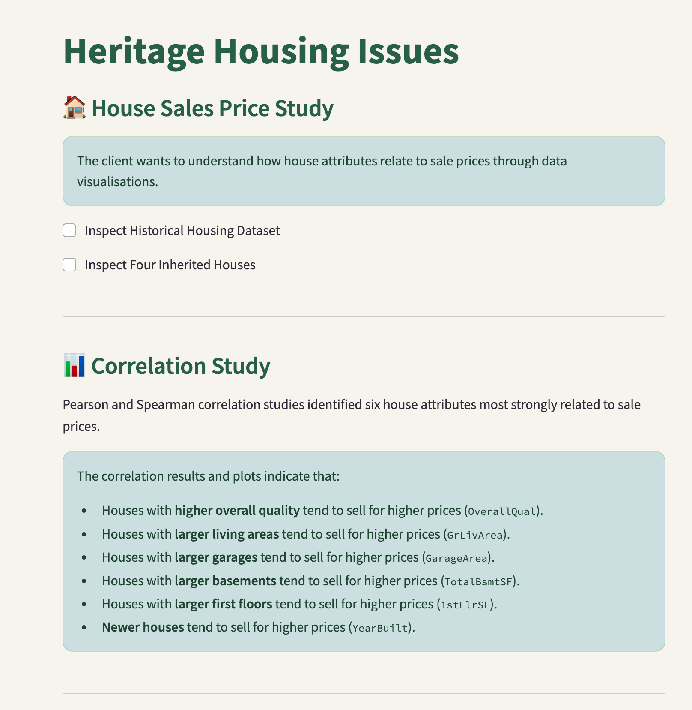
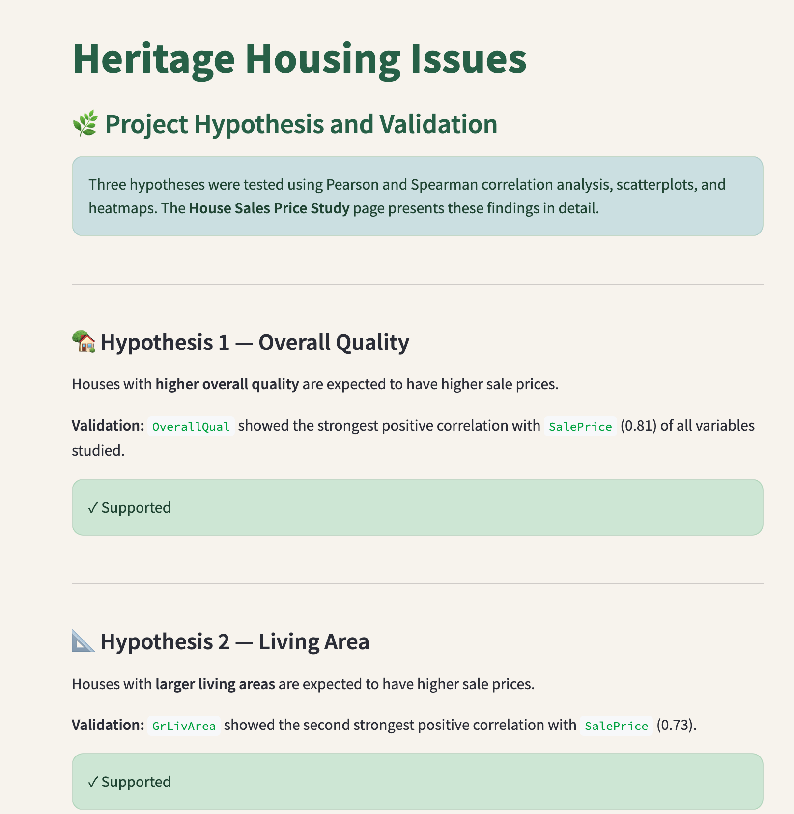
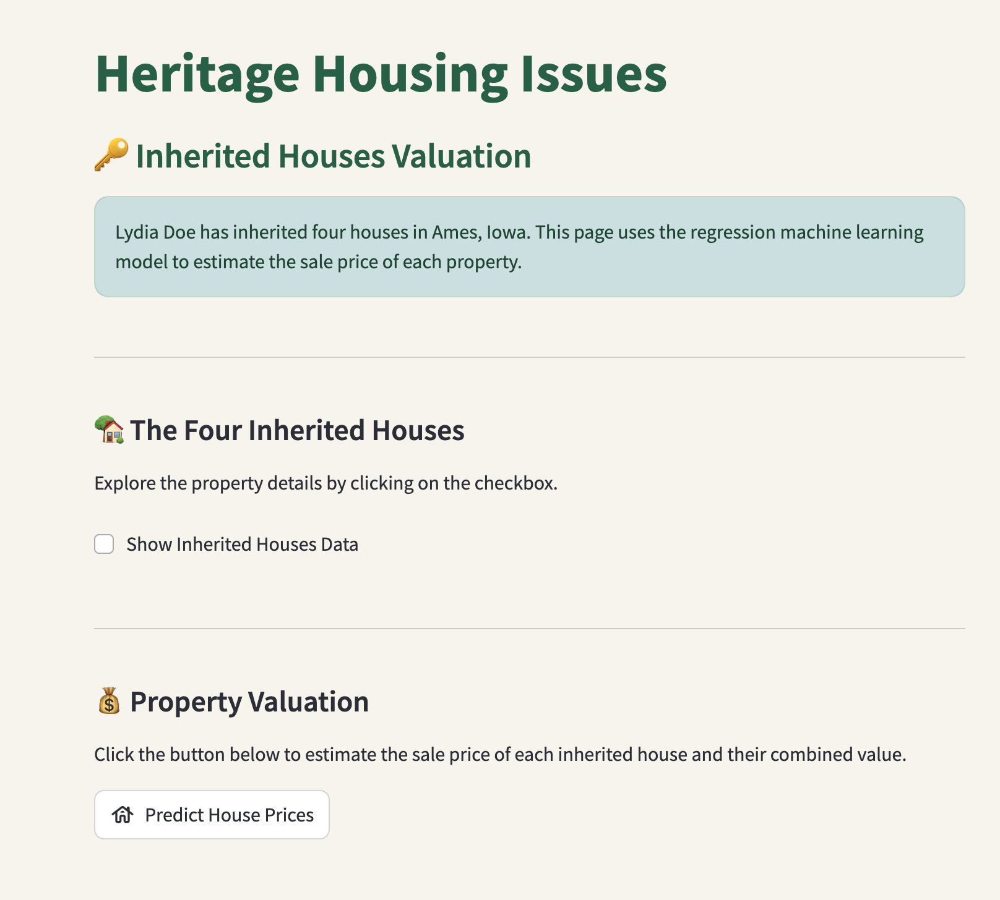
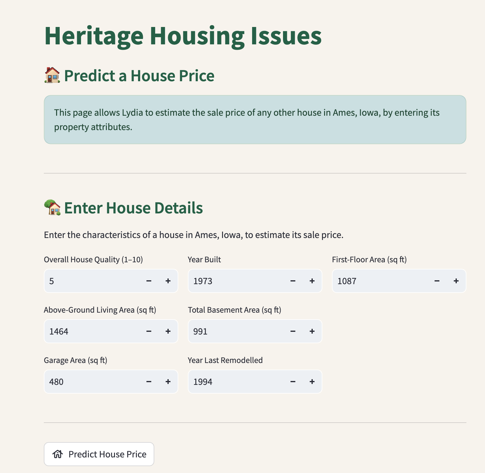
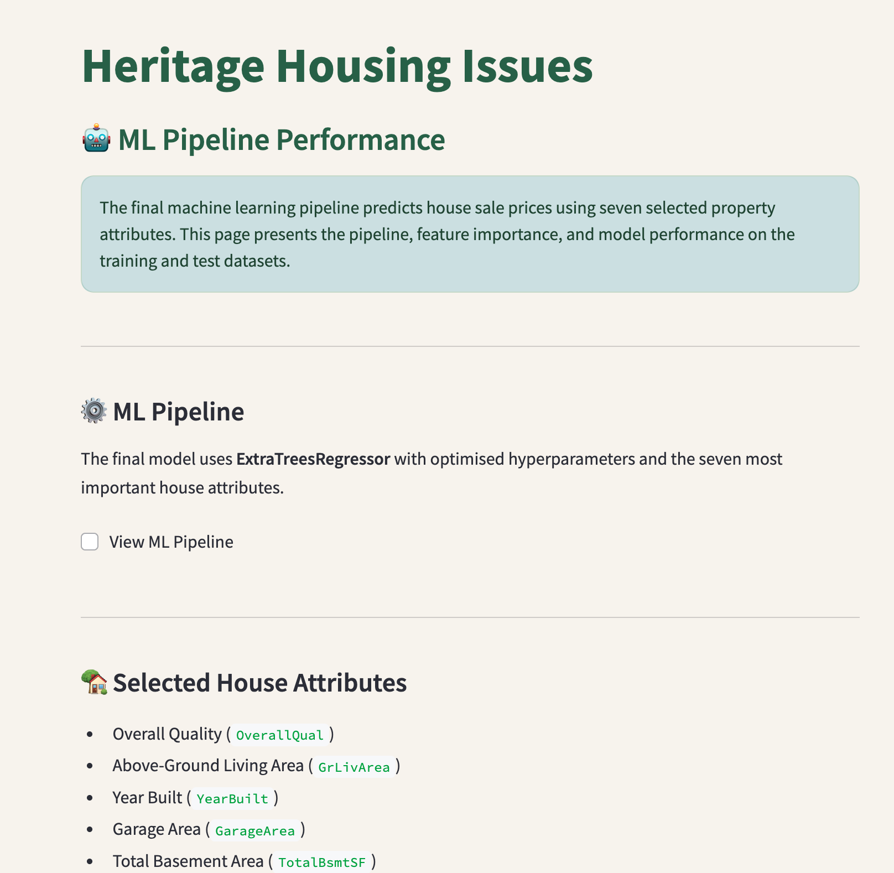

# 🏠 Heritage Housing Issues

---

## 🏠 Project Overview

Lydia Doe has inherited four houses located in Ames, Iowa, USA. Although she has knowledge of property prices in her home country of Belgium, she is unfamiliar with the housing market in Ames and is concerned that this could lead to inaccurate property valuations.

The purpose of this project is to use historical housing data from Ames, Iowa, to investigate the factors associated with house sale prices and develop a machine learning model capable of predicting property values.

The project will deliver a Streamlit dashboard that allows Lydia to explore the factors associated with house prices, view predicted sale prices for the four inherited properties, and predict the sale price of other houses in Ames.

---

## 📊 Dataset Content

The dataset was sourced from <a href="https://www.kaggle.com/codeinstitute/housing-prices-data" target="_blank">Kaggle</a> and contains housing records from **Ames, Iowa, USA**. It is used within a fictitious business scenario where predictive analytics can help estimate residential property values.

### 📋 Dataset Overview

| | |
|---|---|
| **Number of records** | 1,460 properties |
| **Number of variables** | 24 |
| **Target variable** | `SalePrice` |
| **Location** | Ames, Iowa, USA |
| **Construction years represented** | 1872–2010 |
| **Analysis type** | Regression / Predictive Analytics |

The dataset describes a range of property characteristics, including floor area, basement and garage features, kitchen quality, lot dimensions, property condition and quality, construction dates, and sale price.

### 🏠 Variable Definitions

<strong>Click to view the dataset variable definitions</strong>

|Variable|Meaning|Units|
|:----|:----|:----|
|1stFlrSF|First Floor square feet|334 - 4692|
|2ndFlrSF|Second-floor square feet|0 - 2065|
|BedroomAbvGr|Bedrooms above grade (does NOT include basement bedrooms)|0 - 8|
|BsmtExposure|Refers to walkout or garden level walls|Gd: Good Exposure; Av: Average Exposure; Mn: Minimum Exposure; No: No Exposure; None: No Basement|
|BsmtFinType1|Rating of basement finished area|GLQ: Good Living Quarters; ALQ: Average Living Quarters; BLQ: Below Average Living Quarters; Rec: Average Rec Room; LwQ: Low Quality; Unf: Unfinshed; None: No Basement|
|BsmtFinSF1|Type 1 finished square feet|0 - 5644|
|BsmtUnfSF|Unfinished square feet of basement area|0 - 2336|
|TotalBsmtSF|Total square feet of basement area|0 - 6110|
|GarageArea|Size of garage in square feet|0 - 1418|
|GarageFinish|Interior finish of the garage|Fin: Finished; RFn: Rough Finished; Unf: Unfinished; None: No Garage|
|GarageYrBlt|Year garage was built|1900 - 2010|
|GrLivArea|Above grade (ground) living area square feet|334 - 5642|
|KitchenQual|Kitchen quality|Ex: Excellent; Gd: Good; TA: Typical/Average; Fa: Fair; Po: Poor|
|LotArea|Lot size in square feet|1300 - 215245|
|LotFrontage|Linear feet of street connected to property|21 - 313|
|MasVnrArea|Masonry veneer area in square feet|0 - 1600|
|EnclosedPorch|Enclosed porch area in square feet|0 - 286|
|OpenPorchSF|Open porch area in square feet|0 - 547|
|OverallCond|Rates the overall condition of the house|10: Very Excellent; 9: Excellent; 8: Very Good; 7: Good; 6: Above Average; 5: Average; 4: Below Average; 3: Fair; 2: Poor; 1: Very Poor|
|OverallQual|Rates the overall material and finish of the house|10: Very Excellent; 9: Excellent; 8: Very Good; 7: Good; 6: Above Average; 5: Average; 4: Below Average; 3: Fair; 2: Poor; 1: Very Poor|
|WoodDeckSF|Wood deck area in square feet|0 - 736|
|YearBuilt|Original construction date|1872 - 2010|
|YearRemodAdd|Remodel date (same as construction date if no remodelling or additions)|1950 - 2010|
|SalePrice|Sale Price|34900 - 755000|

---

## Project Terms & Jargon

The following terms are used throughout the project and its Streamlit dashboard:

- **SalePrice:** The price at which a house was sold. This is the target variable the machine learning model aims to predict.
- **House attributes:** Property characteristics such as living area, overall quality, year built, garage area, basement size and kitchen quality.
- **Correlation:** A statistical relationship between two variables, used in this project to investigate how house attributes relate to sale prices.
- **Regression:** A machine learning technique used to predict numerical values, such as house sale prices.
- **R² score:** A measure of how well the regression model explains variation in house sale prices.
  
---

## 🎯 Business Requirements

### Client Background

As a good friend, you are requested by your friend, who has received an inheritance from a deceased great-grandfather located in Ames, Iowa, to help in maximising the sales price for the inherited properties.

Although your friend has an excellent understanding of property prices in her own state and residential area, she fears that basing her estimates for property worth on her current knowledge might lead to inaccurate appraisals. What makes a house desirable and valuable where she comes from might not be the same in Ames, Iowa. She found a public dataset with house prices for Ames, Iowa, and will provide you with that.

### Business Requirements

1. The client is interested in discovering how the house attributes correlate with the sale price. Therefore, the client expects data visualisations of the correlated variables against the sale price to show that.

2. The client is interested in predicting the house sale price from her four inherited houses and any other house in Ames, Iowa.

### Prediction Error

The client requires the predictive model to achieve an R² score of at least **0.75 on both the training and test datasets**.

An R² score of 0.75 indicates that the model explains approximately 75% of the variation in house sale prices.

The model is designed to provide an **estimated sale price rather than an exact property valuation** this is why 0.75 is deemed to be sufficient in this case.

In other machine learning models, for example diagnostics a higher R² score would be required.

---

## 🔄 CRISP-DM Workflow

This project will be completed in line with CRISP-DM which is a framework used to plan and organise data science projects.

It has six steps which are outlined below. These steps are iterative rather than linear. For example something might be identified in a later step which encourages the data practicioner to revisit a previous step.

| Phase | Description |
|---|---|
| **1. Business Understanding** | Define the business problem, objectives and business requirements. |
| **2. Data Understanding** | Collect and explore the data, assess its quality and identify correlations. |
| **3. Data Preparation** | Clean and prepare the data, handling missing values, errors and feature transformations. |
| **4. Modelling** | Select machine learning techniques and train models. |
| **5. Evaluation** | Test the model on unseen data. |
| **6. Deployment** | Make the model accessible to users via a dashboard or an API. |

This framework works hand in hand with Agile development - creating user stories to help to organise task.

---

## 📋 Agile Methodology

GitHub Projects was used to manage the development of this project using an Agile approach.

The project was organised into five epics, represented by GitHub Milestones, and 12 user stories, represented by GitHub Issues.

Each user story includes acceptance criteria, a task list and a MoSCoW priority. Completed tasks were marked as done, and all 12 user stories were moved to the Done column on the GitHub Project board.

The [GitHub Project Board](https://github.com/users/cgrace0044/projects/6/views/1) provides an overview of the project's development and completed tasks.

### User Stories by Epic

Click on each epic to view its user stories.

<strong>📋 Epic 1: Information Gathering and Data Collection</strong>

- **[User Story 1 — Understanding the Business Case](https://github.com/cgrace0044/milestone-project5-heritage-housing-issues/issues/1)** — As a data practitioner, I want to understand the client's business problem, objectives, requirements and success criteria so that I can plan the project to meet the client's needs.
- **[User Story 2 — Collect and Explore the Data](https://github.com/cgrace0044/milestone-project5-heritage-housing-issues/issues/2)** — As a data practitioner, I want to collect and explore the Heritage Housing data so that I can assess its suitability for analysing house prices and developing a prediction model.

<strong>📊 Epic 2: Data Visualisation, Cleaning and Preparation</strong>

- **[User Story 3 — Clean and Prepare Datasets](https://github.com/cgrace0044/milestone-project5-heritage-housing-issues/issues/3)** — As a data practitioner, I want to clean and prepare the Heritage Housing datasets so that they are suitable for analysis and regression machine learning.
- **[User Story 4 — Patterns and Correlations in the Data](https://github.com/cgrace0044/milestone-project5-heritage-housing-issues/issues/4)** — As a data practitioner, I want to perform a correlation analysis and prepare data visualisations so that I can advise the client which house attributes are most strongly associated with sale prices.
- **[User Story 5 — Feature Engineering](https://github.com/cgrace0044/milestone-project5-heritage-housing-issues/issues/5)** — As a data practitioner, I want to perform feature engineering so that the data is ready for training a regression machine learning model.

<strong>🤖 Epic 3: Model Training, Optimisation and Validation</strong>

- **[User Story 6 — Develop a Regression Model](https://github.com/cgrace0044/milestone-project5-heritage-housing-issues/issues/6)** — As a data practitioner, I want to develop and compare regression machine learning models so that I can identify a suitable method for predicting house sale prices.
- **[User Story 7 — Optimise Regression Machine Learning Model](https://github.com/cgrace0044/milestone-project5-heritage-housing-issues/issues/7)** — As a data practitioner, I want to optimise the machine learning model so that I can improve the selected model's performance.

<strong>🖥️ Epic 4: Dashboard Planning, Design and Development</strong>

- **[User Story 8 — Create Streamlit Dashboard](https://github.com/cgrace0044/milestone-project5-heritage-housing-issues/issues/8)** — As a data practitioner, I want to design a Streamlit dashboard so that the client can easily explore the answers to their two business requirements.
- **[User Story 9 — Develop Project Summary, House Price Study and Hypothesis Pages](https://github.com/cgrace0044/milestone-project5-heritage-housing-issues/issues/9)** — As a data practitioner, I want to develop the Project Summary, House Price Study and Hypothesis pages so that the client can understand the project and how house attributes correlate with sale prices.
- **[User Story 10 — Create Pages for House Price Prediction and ML Performance](https://github.com/cgrace0044/milestone-project5-heritage-housing-issues/issues/10)** — As a data practitioner, I want to develop the house price prediction and ML performance pages so that the client can estimate property values and understand the model's performance.

<strong>🚀 Epic 5: Dashboard Deployment and Release</strong>

- **[User Story 11 — Prepare Streamlit Dashboard for Deployment to Heroku](https://github.com/cgrace0044/milestone-project5-heritage-housing-issues/issues/11)** — As a data practitioner, I want to deploy the Streamlit dashboard to Heroku so that the client can access the dashboard online.
- **[User Story 12 — Complete Project Documentation and Testing](https://github.com/cgrace0044/milestone-project5-heritage-housing-issues/issues/12)** — As a data practitioner, I want to complete the project documentation and perform final testing to ensure that the project meets the client's requirements and is ready for submission.

---

### 🌿 Project Hypothesis and Validation

Three hypotheses were tested using Pearson and Spearman correlation analysis, scatterplots, and heatmaps. The **House Sales Price Study** page presents these findings in detail.

#### 🏡 Hypothesis 1 — Overall Quality

Houses with **higher overall quality** are expected to have higher sale prices.

**Validation:** `OverallQual` showed the strongest positive correlation with `SalePrice` (0.81) of all variables studied.

**✓ Supported**

#### 📐 Hypothesis 2 — Living Area

Houses with **larger living areas** are expected to have higher sale prices.

**Validation:** `GrLivArea` showed the second strongest positive correlation with `SalePrice` (0.73).

**✓ Supported**

#### 📅 Hypothesis 3 — Year Built

**Newer houses** are expected to have higher sale prices.

**Validation:** `YearBuilt` showed a positive correlation with `SalePrice` (0.65), although this relationship was weaker than those observed for overall quality and living area.

**✓ Supported**

---

## 🧩 Rationale for Mapping Business Requirements to Data Visualisations and ML Tasks

### Business Requirement 1: Data Visualisation and Correlation Study

- We will inspect the data related to historical housing prices.
- We will conduct a correlation study (Pearson and Spearman) to better understand how the variables are correlated with `SalePrice`.
- We will plot the main variables against `SalePrice` to visualise insights.

### Business Requirement 2: Supervised Machine Learning Regression Model

- We want to build a supervised machine learning regression model that is capable of predicting house prices.
- House attributes will be used to predict house price for both the four inherited houses and also any house in Ames Iowa.
- We will aim to achieve an R² score of at least 0.75 on both the training and test sets.
- We will create an interactive dashboard whereby users can enter house attributes to obtain a predicted sale price.

---

## 🤖 ML Business Case

### Predict House Price

#### Regression Model

- We want an ML model to predict house prices based on historical housing data from Ames, Iowa. The target variable is `SalePrice`, measured in US dollars.
- Our ideal outcome is to provide our client with a reliable way to predict house prices with the lowest possible degree of error.
- The model success metrics are:
  - An R² score of at least **0.75 on both the training and test sets**.
- The ML regression model is deemed unsuccessful if it does not meet this performance standard.
- There will be a Streamlit dashboard with pages showing:
  - The predicted sale prices of the four inherited properties.
  - An interactive interface where users can enter house attributes to predict the sale price of a previously unseen property.
- **Heuristics:** Currently, there is no established approach for predicting house prices. The client has good knowledge of the property market in her own area but not in Ames, Iowa.
- The training data comes from the historical Ames, Iowa housing dataset provided by Code Institute.
  - **Target:** `SalePrice`.
  - **Features:** House attributes selected during the machine learning pipeline development.

---

## Dashboard Design

The Heritage Housing dashboard was built using Streamlit and deployed to Heroku.

[View the Live Dashboard](https://project5-heritage-housing-25399c2d2f27.herokuapp.com/)

### Page 1: Quick Project Summary

- Introduces the project.
- Provides an overview of the dataset.
- Outlines project terms and jargon.
- Lists business requirements and project success criteria.
- Provides a link to the README file.

View Quick Project Summary Page

### Page 2: Data Cleaning

- Explains why data cleaning is necessary.
- Outlines the data cleaning performed, which includes a violin plot section.
- Displays the outcome of data cleaning.

View Data Cleaning Page

### Page 3: House Sales Price Study

- Allows users to inspect the historical housing dataset and four inherited houses.
- Identifies six house attributes strongly correlated with sale price.
- Displays interactive scatterplots with interpretations.
- Provides a Spearman correlation heatmap.

View House Sales Price Study Page

### Page 4: Project Hypothesis and Validation

- Presents three hypotheses relating house attributes to sale prices.
- Outlines the validation for each hypothesis.
- Shows whether each hypothesis was supported.

View Project Hypothesis Page

### Page 5: Inherited Houses Valuation

- Allows the user to inspect the details of the four inherited houses.
- Predicts sale prices for the four inherited houses.
- Displays the combined predicted sale price.

View Inherited Houses Valuation Page

### Page 6: Predict a House Price

- Allows users to enter property attributes to generate predictions for other houses in Ames, Iowa.

View Predict a House Page

### Page 7: ML Pipeline Performance

- Displays the final ExtraTreesRegressor pipeline and the steps involved.
- Displays the features used to train the model, together with a feature importance plot.
- Shows the model evaluation results for both the training and test sets.
- Outlines actual vs. predicted sale price plots.

View ML Pipeline Page

## 🐛 Unfixed Bugs

There are no unfixed bugs.

---

## 🚀 Deployment

### Heroku

* The App live link is: <https://project5-heritage-housing-25399c2d2f27.herokuapp.com/>
* Set the .python-version Python version to a [Heroku-24](https://devcenter.heroku.com/articles/python-support#supported-runtimes) stack currently supported version.
* The project was deployed to Heroku using the following steps.

1. Log in to Heroku and create an App.
2. At the Deploy tab, select GitHub as the deployment method.
3. Select your repository name and click Search. Once it is found, click Connect.
4. Select main, then click Deploy Branch.

---

## 🛠️ Main Data Analysis and Machine Learning Libraries

- **[Pandas](https://pandas.pydata.org/docs/)** – Data cleaning and analysis.
- **[NumPy](https://numpy.org/doc/stable/)** – Numerical operations.
- **[Matplotlib](https://matplotlib.org/stable/)** – Data visualisation.
- **[Seaborn](https://seaborn.pydata.org/)** – Statistical visualisations.
- **[Scikit-learn](https://scikit-learn.org/stable/)** – Machine learning modelling and evaluation.
- **[Feature-engine](https://feature-engine.trainindata.com/)** – Feature engineering and selection.
- **[XGBoost](https://xgboost.readthedocs.io/en/stable/)** – Regression modelling.
- **[Joblib](https://joblib.readthedocs.io/en/stable/)** – Model saving and loading.
- **[Streamlit](https://docs.streamlit.io/)** – Interactive dashboard development.

---

## 📚 Credits

- **Code Institute:** The Churnometer walkthrough and course materials provided guidance and code examples, which were adapted to meet the requirements of the Heritage Housing Issues project.
- **Dataset:** The housing dataset was provided by Code Institute and is available on [Kaggle](https://www.kaggle.com/datasets/codeinstitute/housing-prices-data).
- **[Scikit-learn — ExtraTreesRegressor](https://scikit-learn.org/stable/modules/generated/sklearn.ensemble.ExtraTreesRegressor.html):** Used to develop the final regression model and investigate hyperparameter optimisation to improve house sale price predictions.
- **[Scikit-learn — RandomForestRegressor](https://scikit-learn.org/stable/modules/generated/sklearn.ensemble.RandomForestRegressor.html):** Used to investigate hyperparameter combinations during the initial regression model optimisation.
- **[Lucidchart](https://www.lucidchart.com/)** — Used to create the CRISP-DM methodology diagram featured in this README.

---

## 🙏 Acknowledgements

I would like to thank my mentor, **Can Sücüllü**, for his guidance, support and valuable feedback throughout the development of this project.
