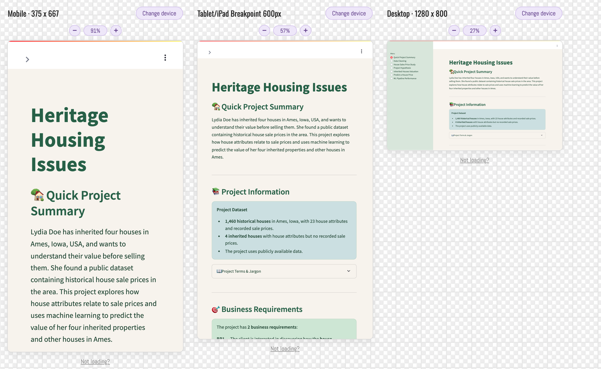

# Testing

This document records testing carried out for the **Heritage Housing Issues** project.

## Manual Dashboard Testing

Manual testing was completed on the deployed [Heritage Housing Issues Dashboard](https://project5-heritage-housing-25399c2d2f27.herokuapp.com/). All 46 documented checks passed.

<strong>Test 1 — Dashboard Navigation ✅</strong>

| Check | Result |
| --- | --- |
| Application loads successfully | ✅ |
| All seven dashboard pages are listed | ✅ |
| All seven pages open successfully | ✅ |
| Navigation between pages works | ✅ |

<strong>Test 2 — Quick Project Summary ✅</strong>

| Check | Result |
| --- | --- |
| Project introduction and dataset information display correctly | ✅ |
| Project terminology expander opens and displays its content | ✅ |
| Both business requirements display correctly | ✅ |
| Training R² of 0.925 and test R² of 0.825 display correctly | ✅ |
| Project README link is available | ✅ |

<strong>Test 3 — Data Cleaning ✅</strong>

| Check | Result |
| --- | --- |
| Introduction and cleaning methods display correctly | ✅ |
| Numerical data distributions expander works | ✅ |
| Violin plots display for `BedroomAbvGr`, `LotFrontage`, `MasVnrArea` and `2ndFlrSF` | ✅ |
| Metrics show 1,460 houses, 21 variables and 0 missing values | ✅ |
| Page displays without errors | ✅ |

<strong>Test 4 — House Sales Price Study ✅</strong>

| Check | Result |
| --- | --- |
| Historical housing dataset displays its first 10 rows | ✅ |
| Four inherited houses are displayed | ✅ |
| Six correlated attributes are presented | ✅ |
| All six scatterplots and their interpretations display | ✅ |
| Notes about excluded zero values display | ✅ |
| Correlation heatmap and its interpretation display | ✅ |

<strong>Test 5 — Project Hypothesis and Validation ✅</strong>

| Check | Result |
| --- | --- |
| Page introduction displays | ✅ |
| Overall quality correlation of 0.81 displays | ✅ |
| Above-ground living area correlation of 0.73 displays | ✅ |
| Year built correlation of 0.65 displays | ✅ |
| Hypotheses are shown as supported, with explanations | ✅ |

<strong>Test 6 — Inherited Houses Valuation ✅</strong>

| Check | Result |
| --- | --- |
| Page introduction displays | ✅ |
| Data for all four inherited houses can be viewed | ✅ |
| Predict House Prices button works | ✅ |
| Individual predicted prices display for all four houses | ✅ |
| Combined predicted value equals the sum of the four predictions | ✅ |

<strong>Test 7 — Predict a House Price ✅</strong>

| Check | Result |
| --- | --- |
| Page introduction displays | ✅ |
| All seven feature inputs and their default values display | ✅ |
| All seven inputs can be changed | ✅ |
| Prediction works with default inputs | ✅ |
| Prediction works with modified inputs | ✅ |
| A positive predicted house price is displayed | ✅ |

<strong>Test 8 — ML Pipeline Performance ✅</strong>

| Check | Result |
| --- | --- |
| Page introduction displays | ✅ |
| Pipeline checkbox reveals the ExtraTreesRegressor model | ✅ |
| Seven selected model features display | ✅ |
| Feature importance graph displays | ✅ |
| Performance table shows training R² of 0.925 and test R² of 0.825 | ✅ |
| Actual-versus-predicted plots display for training and test data | ✅ |
| Interpretations and associated checkboxes display and work | ✅ |

<strong>Test 9 — Responsive Design ✅</strong>

Responsive layouts were checked using [Responsive Test Tool](https://responsivetesttool.com/).

| Check | Result |
| --- | --- |
| Desktop layout displays correctly | ✅ |
| Tablet layout displays correctly | ✅ |
| Mobile layout displays correctly | ✅ |

**Responsive Design Screenshot**

## PEP8 Code Validation

Python files were checked using the [Code Institute PEP8 Validator](https://pep8ci.herokuapp.com/). Reported formatting issues were corrected and retested. All 11 files passed.

| Python file / component | Result |
| --- | --- |
| `app.py` | ✅ |
| Page 1 — Quick Project Summary | ✅ |
| Page 2 — Data Cleaning | ✅ |
| Page 3 — House Sales Price Study | ✅ |
| Page 4 — Project Hypothesis and Validation | ✅ |
| Page 5 — Inherited Houses Valuation | ✅ |
| Page 6 — Predict a House Price | ✅ |
| Page 7 — ML Pipeline Performance | ✅ |
| Regression evaluation supporting Python file | ✅ |
| `src/data_management.py` | ✅ |
| `src/machine_learning/predictive_analysis_ui.py` | ✅ |

## Jupyter Notebook Code Validation

All five Jupyter notebooks were checked using **Ruff** in GitHub Codespaces for common Python code issues and line-length violations. Reported issues were corrected and each notebook passed on retesting.

| Jupyter notebook | Result |
| --- | --- |
| `01 - DataCollection.ipynb` | ✅ |
| `02_DataCleaning.ipynb` | ✅ |
| `03_HousePriceStudy.ipynb` | ✅ |
| `04_FeatureEngineering.ipynb` | ✅ |
| `05_Modeling and Evaluation Predict SalePrice.ipynb` | ✅ |

Ruff validates code quality; it does not execute the notebooks.

## Testing Outcome

All **46 documented manual dashboard checks**, **11 Python files** and **5 Jupyter notebooks** passed their respective checks. Notebook execution testing has not been recorded as completed.